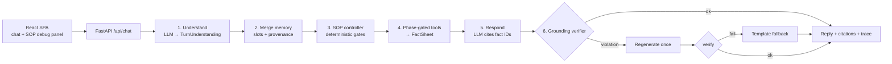

# SOP-Guided Insurance Claims Agent

A conversational insurance-claims support agent that follows a fixed SOP:
**VERIFY_ID → RESOLVE_INTENT → PROCESS_CASE → POST_PROCESS**. It is strict where the SOP demands it
(identity gate, consent, allowed actions), flexible where reasoning helps (messy intent, grounded
follow-ups), and keeps memory across phase boundaries.

The core design principle, taken from how Rasa, Parlant and Sierra solved the same problem (see
[RESEARCH.md](RESEARCH.md)): **the LLM interprets and phrases; deterministic code owns the workflow, the
gates and the data.** Every factual statement the agent makes must cite a fact from a tool result, and a
verifier checks this before each reply is sent.

---

## Quick start

### Docker (one container, one port)

```bash
docker build -t sop-agent .
docker run --rm -p 8000:8000 -e OPENAI_API_KEY=sk-... sop-agent
# open http://localhost:8000
```

The token can also be pasted into the **OpenAI API key** field in the UI. It is sent per request in the
`X-OpenAI-Key` header and kept only in the browser's sessionStorage. With no key at all, the app runs in
**offline mode** (deterministic regex understanding + template replies), which is useful for trying the
SOP gates without a model.

The agent, the groundedness judge and the simulated callers all run on **`gpt-5.4-nano`**, and every number
in this README and in `evals/` was measured on nano. Optional env vars (see `.env.example`): `OPENAI_MODEL`
(default `gpt-5.4-nano`), `OPENAI_JUDGE_MODEL` (defaults to the agent model), `OPENAI_REASONING_EFFORT`,
`OPENAI_BASE_URL`, `AGENT_TODAY` (business date for derived facts such as "appeal deadline passed"),
`LIVE_JUDGE=true` (runs the groundedness judge on every live reply).

### Local development

```bash
python3 -m venv .venv && .venv/bin/pip install -r apps/insurance_claims/backend/requirements-dev.txt
cd apps/insurance_claims/frontend && npm install && npm run build && cd -   # or `npm run dev` on :5173
cd apps/insurance_claims/backend
OPENAI_API_KEY=sk-... ../../../.venv/bin/uvicorn app.api:app --reload --port 8000
```

### Tests and evals

```bash
cd apps/insurance_claims/backend
../../../.venv/bin/pytest                                   # 62 offline tests, live tests skipped
OPENAI_API_KEY=sk-... ../../../.venv/bin/pytest -m llm      # same scenario specs against the live model + judge
../../../.venv/bin/python -m evals.run_evals --offline      # scorecard -> evals/report.md
OPENAI_API_KEY=sk-... ../../../.venv/bin/python -m evals.run_evals --k 3 --judge   # pass^3 + faithfulness
```

### Submission zip

```bash
scripts/make_submission_zip.sh     # excludes node_modules, dist, .venv, caches, outbox, .env
```

---

## Demo walkthrough (the Context.md test case)

Click **Demo test case** in the UI (or type it):

> I'm the policyholder. My name is Margaret Chen, policy POL-9921. I'm calling about my denied healthcare
> claim from January. DOB is 1985-03-15, SSN last four is 4472.

1. **VERIFY_ID.** Name + DOB + SSN-last-4 are extracted. The policy number narrows the lookup but doesn't
   count. Three fields match P9 with no conflicts, so the caller is verified.
2. **Memory.** "Denied healthcare claim from January" was stored as `case_hints` (with the turn it was
   heard on) *before* verification. The agent didn't disclose anything while unverified.
3. **RESOLVE_INTENT.** The hints rank Margaret's claims, and CL-2048 (healthcare, denied, created
   2026-01-12) is selected **without asking from scratch**.
4. **PROCESS_CASE.** The status, denial reason, needed documents and appeal deadline (marked *passed*
   relative to `AGENT_TODAY`) come only from the claim record. Follow-ups such as "how long after I
   submit?", "what format?" or "I don't have the pathology report" are answered from the guideline file.
   Each reply has a **citations** toggle.
5. **POST_PROCESS.** "That's all" brings an offer to email a summary (topics, status, next steps) to the
   masked email on file. The caller chooses **Send** or **Skip**. A sent email is written to
   `backend/outbox/*.json`.

Try the other sample chips too: *Hint first* (memory across turns), *Frustrated* (the bonus
example), *Representative* (consent flow), *Off-topic* ×3, *Injection*, *No document*. The right-hand
panel shows the phase, identity gate, remembered slots, selected case, guardrail counters, email preview,
the facts the responder was allowed to use, and the full event trace.

---

## Architecture

More diagrams are in [`docs/architecture/`](docs/architecture/): system overview, state machine, turn
sequence, and grounding/eval layers.

```mermaid
stateDiagram-v2
    [*] --> VERIFY_ID
    VERIFY_ID --> RESOLVE_INTENT: ≥3 PII match (+ rep consent)
    VERIFY_ID --> HUMAN_TRANSFER: 3 failures / consent timeout / accepts transfer
    RESOLVE_INTENT --> PROCESS_CASE: case resolved from remembered hints
    PROCESS_CASE --> RESOLVE_INTENT: refers to another own claim
    PROCESS_CASE --> POST_PROCESS: caller done
    PROCESS_CASE --> HUMAN_TRANSFER: alternatives exhausted / accepts transfer
    POST_PROCESS --> ENDED: send or skip email
    POST_PROCESS --> PROCESS_CASE: new question
```





### How each requirement is met

| Requirement | Mechanism | Code |
|---|---|---|
| Strict VERIFY_ID: ≥3 of name/DOB/phone/email/SSN-4, no disclosure | Deterministic `verify()` (normalization, aliases, 0 conflicts), claim tools gated by phase **and** verification, verifier rejects claim tokens pre-verification, failed field never revealed, lockout after 3 | `sop/verification.py`, `tools.py`, `grounding/verifier.py` |
| Partial answers, refusals, alternate ID fields | Slots accumulate across turns; remaining options offered; SSN or national-ID last 4; name/phone/email aliases | `sop/controller.py::_verify_id` |
| Flexible RESOLVE_INTENT / PROCESS_CASE | LLM interprets messy language into intent/hints/topics; controller ranks claims, disambiguates, switches case | `understanding.py`, `_resolve_intent`, `_process_case` |
| Grounded answers only | FactSheet with IDs, mandatory citations, deterministic verifier, regenerate, template fallback; LLM judge in evals | `grounding/*`, `pipeline.py` |
| Memory across phases | Every message merges into `Memory` with turn provenance, whatever the phase | `_merge_memory` |
| Email summary, send or skip | Summary built deterministically from state + claim record; explicit choice required | `build_email_summary`, `_post_process` |
| Out-of-scope refusal, then human | Input classification, streak counter, transfer offer after 3 | `step()` guards |
| Bonus: emotion + SOP recovery | Emotion signal, empathy first, explain why, offer allowed options, bounded persuasion, escalate | `EMPATHY`, `EXPLAIN_VERIFICATION`, `_offer_human` |
| Representative caller | Rep must be on file (relationship from either side), then policyholder consent via `consent_scenarios.json`; claim data gated until approved | `representative_authorized`, `_consent_step` |

### Grounding: what is checked on every reply

`grounding/verifier.py` rejects a draft if any of the following hold:

- It cites a fact ID that wasn't fetched this turn.
- It names a case ID not in the facts or not owned by the verified caller.
- It states an amount, date or timeline ("within 30 days") not in the facts.
- It names a document not requested for this claim.
- It reads out record PII the caller didn't say.
- A claim's text contains a value its cited facts don't.
- Claim facts exist before verification.

It then runs the **boundary gates** (`grounding/gates.py`). Each gate was added for a failure found in
live evals or the UI, and each traces back to Context.md / RESEARCH.md:

| Gate | Blocks | Example caught |
|---|---|---|
| G1 commitments | promises no fact backs (handoff details, guarantees, speed) | "You won't need to repeat yourself" |
| G2 outcome predictions | predicting approval, payment or consent | "She will approve it", "You'll get $1,450" |
| G3 capabilities | "I can email…", "I can connect you…", "I can only help with…" without the `sop.*`/`email.*` fact | email offer with no email fact |
| G4 state contradictions | telling a verified caller to verify, or an unverified caller they're verified | "I can't skip verification" to a verified caller |
| G5 addressing | calling a representative by the policyholder's name | "Thank you, Margaret" to David |
| G6 scope discipline | answering an off-topic question, or offering a human before the 3-retry threshold | "RL stands for…" |
| G7 session context | "you said / I've noted…" with nothing in memory, or quoting values the caller never typed | "You said your DOB is 2000-12-03" for input "12/03/200" |
| G8 decision fidelity | a reply that doesn't state the controller's outcome, or narrates work that isn't happening | "I've noted your details and I'll check them now" after a failed match |

All gates normalize typographic quotes first (a live reply's "won’t" with U+2019 slipped past ASCII patterns).

**Input-side grounding** (`grounding/extraction_guard.py`, before the controller):
- Every value the model extracts must appear in the caller's own message. An invented year
  ("12/03/200" → 2000-12-03), a model-"corrected" name spelling, a representative's own name used as the
  policyholder's, or a claim status/type/month the caller never said is dropped (or reverted to the
  caller's literal words).
- Dropped identity fields trigger `CLARIFY_FIELDS` and **do not consume a verification attempt**.
- Small models also *omit* values. For format-rigid fields (dates, phone, email, ID digits, policy and
  case IDs, claim hints), a regex extractor reading the raw text fills what the model left empty.
  High-precision injection and off-topic detectors and follow-up-topic phrases are OR-ed with the model's
  flags, so one model miss can't reopen a gate.

Text quoted word-for-word from a fact is exempt from G1 and G2 (guideline wording is grounded by definition).
The agent's own rules (`sop.scope`, `sop.human_transfer`, `sop.after_verification`,
`sop.passed_deadline_review`) are emitted as facts, so statements about scope and capabilities are cited
rather than improvised.

A rejected draft is regenerated once with the violations listed, then replaced by the deterministic
template.

### Test layers

1. **Unit** (`test_verification.py`, `test_tools_gating.py`, `test_grounding_verifier.py`, `test_gates.py`,
   `test_session_context_guards.py`): the identity
   rule, tool gates, and **planted hallucinations** (invented amount, date, timeline, document,
   cross-party case, PII read-out), each of which must be caught.
2. **Scenario specs** (`fixtures/specs/scenarios.json`, 16 core + 15 `edge_case` scenarios, each edge case
   tagged with the gate it exercises and the failure it came from): run end to end offline
   (`test_scenarios_offline.py`) and live (`test_scenarios_llm.py`), asserting on phase per turn, verified
   turn, selected case, memory use, email choice, forbidden content and required facts.
3. **Trace properties** (`grounding/trace_rules.py`, AgentLTL-style) on every scenario: no claim tool or
   disclosure before verification/consent, no cross-party disclosure, every reply verified, legal phase
   order, email only after an offer.
4. **LLM path with a fake model** (`test_llm_path_fake.py`): a hallucinating model is caught,
   regenerated, and falls back to the template.
5. **Live evals** (`evals/run_evals.py`): pass^k reliability plus an enumerate-then-verify groundedness
   judge (faithfulness = supported / total claims).

---

## Project layout

```
apps/insurance_claims/
  fixtures/                 starter data (+ specs/scenarios.json: executable conversation specs)
  backend/app/
    api.py                  FastAPI endpoints + serves the built SPA
    pipeline.py             per-turn pipeline (understand → controller → respond → verify)
    understanding.py        LLM extraction schema + offline heuristic understander
    sop/controller.py       deterministic SOP state machine
    sop/verification.py     identity matching, normalization, representative rules
    tools.py                phase-gated tools → FactSheet
    responder.py            LLM responder + deterministic template responder
    prompts.py              persona, per-phase rules, per-action instructions
    grounding/              factsheet, verifier, trace rules, LLM judge
    evaluation.py           scenario runner shared by tests and evals
  backend/tests/            pytest suites
  backend/evals/            pass^k + judge scorecard
  frontend/                 Vite + React chat UI with SOP debug panel
docs/architecture/          Mermaid diagrams
RESEARCH.md                 industry research: problems, what worked, what didn't
```

## Limitations

- Sessions are in memory, so they are lost on restart. Email is a mock outbox.
- The regex verifier can't catch *semantic* misuse of a real number. The LLM judge covers that in evals
  (see RESEARCH.md, "Known limits").
- The offline heuristic understander is deliberately simple. Use a model key for natural conversations.
