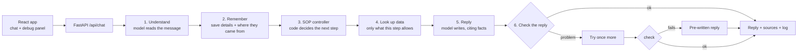
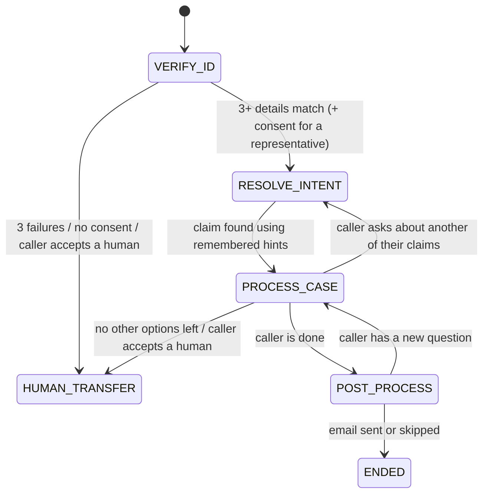

# SOP-Guided Insurance Claims Agent

This is a chat agent for insurance claims support. It talks with callers naturally, but it always follows
the same four-step business process (the SOP):

**VERIFY_ID → RESOLVE_INTENT → PROCESS_CASE → POST_PROCESS**

- **Strict where it has to be.** It shares no claim details until the caller has proven who they are with
  at least 3 matching personal details. It also asks for consent before acting, and only takes actions
  the SOP allows.
- **Flexible where it helps.** It understands messy wording, works out which claim the caller means, and
  answers follow-up questions, but only from real claim data.
- **It remembers.** If the caller mentions something early, for example "I'm calling about my denied claim
  from January" while still verifying, the agent saves it and uses it later instead of asking again.

**The main idea:** the AI model only understands what the caller says and writes the replies. Plain code
decides which step comes next, what is allowed, and what data can be shown. Every fact in a reply has to
point to a record the agent actually looked up, and a checker reviews each reply before it is sent. This is
the same approach that Rasa, Parlant and Sierra use for this problem (see [RESEARCH.md](RESEARCH.md)).

## Try it

**Live demo: https://157-230-226-162.sslip.io**

Paste an OpenAI, OpenRouter or Gemini API key into the key field and start chatting. The server has no key
of its own. Your key stays in this browser tab (sessionStorage), goes along with each message, and is
passed straight to your provider without being stored. With no key, the demo runs in a simple offline mode
with no AI model.

## Check every requirement in about 10 minutes

Open the live demo (or run it with Docker, see below) and paste a key. Then click the sample buttons under
the chat box, or open the **Test cases** drawer. The drawer runs a saved conversation and shows green or red
for whether the agent behaved as expected.

| What Context.md asks for | What to click | Saved test that checks it |
|---|---|---|
| The demo case: identity and claim hint in one message, nothing revealed before verification | **Demo test case** | `margaret_demo_single_utterance` |
| Remember a later-step hint while still verifying | **Hint first**, then the identity line | `memory_across_phase_boundary` |
| At least 3 personal details; partial answers, other ID fields, refusals | **Wrong DOB**, then **Correction**; **Spoken digits** | `edge_field_correction_after_failure`, `edge_spoken_ssn_dob`, `wrong_details_lockout` |
| Understand what the caller wants and answer follow-ups from real data | **Follow-up**, **Switch claim**, **Amount** | `grounded_followups`, `edge_switch_*`, `edge_amount_*` |
| Offer an email summary that the caller can send or skip | type "that's all" | `email_skip`, `edge_email_statements_grounded`, `edge_transfer_then_email_summary` |
| Politely refuse off-topic questions, offer a human after repeated tries | **Off-topic**, three times | `off_topic_escalation` |
| Bonus: calm an upset caller without skipping steps | **Frustrated** | `frustrated_caller_bonus`, `edge_pushback_and_verify_same_turn` |
| All of the above in one long, messy call | Test cases drawer → `long_messy_12_turns` | `long_messy_12_turns` |

Each reply shows a **grounded** badge, the records it is based on, and how long it took, how many tokens it
used and roughly what it cost. The panel on the right shows the current step, the identity check, what the
agent has remembered, the facts it was allowed to use, and a full log of each turn.

## Results (gpt-5.4-nano)

| What was checked | Result | Where to look |
|---|---|---|
| Offline tests (safety gates, data extraction, saved conversations, API, providers) | **223 of 223** pass | `pytest` |
| The same saved conversations run against the live model, plus a check that replies stick to the facts | **48/48** on OpenAI, **47/48** on OpenRouter (same model). The one OpenRouter miss has since been fixed and passed 6 of 6 re-checks. | `pytest -m llm` |
| New test data the agent was never tuned on | **10 of 10** conversations pass | `evals/report_alt.md` |
| AI-played callers (5 personalities × 5 goals × 3 runs each) | **71 of 75** conversations pass; **23 of 25** combinations pass all 3 runs | `evals/simulation_report.md` |
| An impostor who only knows the name and policy number | **never gets through** (15 of 15) | `evals/simulation_report.md` |
| The automatic fact-checker compared with 42 replies labelled by hand | **93%** agreement (κ 0.86, precision 100%, recall 86%) | `evals/judge_calibration.md` |
| Cost per conversation | **about $0.005** | `evals/simulation_report.md` |

**Known weak spots.** These are measured, not hidden. A caller with noisy speech-to-text who asks for a human
fails all 3 runs. A deliberately tricky caller fails 1 of 3 runs that ask about money. In the simulated
calls, 60 of 295 replies were rewritten after the checker rejected them, and 28 were replaced by a safe
pre-written reply. That is the price of never sending a sentence that isn't backed by data.

## Design choices and their trade-offs

- **Code runs the process; the model only reads and writes.** One big prompt would be less code, but a small
  model doesn't follow long prompts reliably, and a rule like "never share claim data before verification"
  needs a guarantee that a prompt can't give. The downside is more code: adding a new claim type or step
  means changing code.
- **A safe pre-written reply is better than an unchecked one.** If a reply fails the checker, the model gets
  one more try. If that also fails, the agent sends a pre-written reply. It sounds stiffer, but the caller
  never hears something made up. How often this happens is reported, so it can't hide problems with the
  model.
- **Fast rule checks while chatting, an AI judge for testing.** The live checks (gates G1–G9) are quick, free
  and give the same answer every time, but a rephrased sentence can slip past them. The AI judge catches
  rephrasing but costs one extra call per reply and misses some subtle cases, so it is used to measure the
  system rather than to guard it.
- **A small model with strong guardrails, not a bigger model.** Each mistake the small model made in live
  testing became a new code check rather than a longer prompt. That keeps a conversation under one cent, and
  a stronger model can be used through the same key field.
- **Fixing one wrong detail doesn't mean starting over.** If verification fails and the caller says "sorry,
  my date of birth is …", the agent keeps the other details they already gave. To keep this safe, the agent
  never says which detail was wrong, each different combination counts as an attempt, and the caller is
  still locked out after 3 failed attempts.

---

## Running it yourself

### With Docker (one container, one port)

```bash
docker build -t sop-agent .
docker run --rm -p 8000:8000 -e OPENAI_API_KEY=sk-... sop-agent   # or: --env-file .env
# open http://localhost:8000
```

You can give the API key as an environment variable, or paste it into the **LLM API key** field in the UI.
The app works out the provider from the start of the key. **OpenAI or OpenRouter is recommended**, because
the full live tests were run on both.

| Provider | Key starts with | Env var | Models tried, in order | Choose a model | How well tested |
|---|---|---|---|---|---|
| OpenAI | `sk-`, `sk-proj-` | `OPENAI_API_KEY` | `gpt-5.4-nano` → `gpt-5.4-mini` | `OPENAI_MODEL` | full live tests (recommended) |
| OpenRouter | `sk-or-` | `OPENROUTER_API_KEY` | `openai/gpt-5.4-nano` → `google/gemini-3.8-flash` | `OPENROUTER_MODEL` | full live tests (recommended) |
| Google Gemini | `AIza` | `GEMINI_API_KEY` | `gemini-3.8-flash` → `gemini-3.5-flash-lite` | `GEMINI_MODEL` | quick demo check only. A free key allows about 20 requests per model per day (roughly 10 chat turns), and replies take about twice as long. |

**Other models.** To use another model family (Claude, Llama, Grok and others), use an OpenRouter key and
type the model name, for example `anthropic/claude-sonnet-5-5`, into the optional **Model** field. Anthropic,
Groq and xAI keys are recognised, but the app shows a message suggesting OpenRouter and continues in offline
mode.

**If a model is unavailable.** Providers sometimes retire model names. For example, Gemini's
`gemini-2.5-flash` started returning "not found" for new keys. When that happens, the app moves on to the
next model in the list, remembers which one worked for that key, and records a `model_fallback` event in the
log. A model you type in the UI, or set with a `*_MODEL` env var, is always tried first.

**Free-tier limits.** A free Gemini key allows about 20 requests per model per day, and each chat turn uses
about two, so that's roughly 10 turns per model. When the daily limit is reached, waiting won't help, so the
app moves to the next model, which has its own limit. When all models are used up, the app says so once and
answers with its pre-written replies. Short per-minute limits are simply retried after a pause.

**Other details.**
- If the key prefix could belong to more than one provider, pick one in the **Provider** dropdown or set
  `LLM_PROVIDER`.
- Any other OpenAI-compatible service works with `LLM_BASE_URL` and `LLM_API_KEY`.
- The UI sends the key with each request in the `X-LLM-Key` header (the older `X-OpenAI-Key` still works).
- The badge at the top shows which provider and model are in use, as `llm:<provider>:<model>`.
- If the provider rejects the key, or none of its models is available, a short error appears, and the turn
  is answered with pre-written replies.
- With no key at all, the app runs in **offline mode**: simple pattern matching and pre-written replies.
  This is enough to try the SOP rules without a model.

**Optional settings** (see `.env.example`):

| Setting | What it does |
|---|---|
| `OPENAI_MODEL`, `GEMINI_MODEL`, `OPENROUTER_MODEL` | Choose the model for that provider. |
| `LLM_MODEL`, `LLM_JUDGE_MODEL` | Choose the agent and judge models for the server's own provider only, so a key pasted for another provider never gets the wrong model name. The judge uses the agent's model by default. |
| `LLM_PROVIDER`, `LLM_BASE_URL` | Force a provider, or point at another OpenAI-compatible service. |
| `OPENAI_REASONING_EFFORT` | Optional thinking level for OpenAI models. |
| `GEMINI_REASONING_EFFORT` | Thinking level for Gemini (default `low`). Gemini 3 Flash models always think, and at their default level each call is several times slower. If the model rejects a level, the app tries the next lower one. |
| `AGENT_TODAY` | The "today" date used for things like "your appeal deadline has passed". |
| `LIVE_JUDGE=true` | Runs the fact-checking judge on every live reply. |
| `LLM_MAX_RETRIES` | How many times to retry after a rate limit (default 6). |

The older names `OPENAI_JUDGE_MODEL`, `OPENAI_BASE_URL` and `OPENAI_MAX_RETRIES` still work.

### For local development

```bash
python3 -m venv .venv && .venv/bin/pip install -r apps/insurance_claims/backend/requirements-dev.txt
cd apps/insurance_claims/frontend && npm install && npm run build && cd -   # or `npm run dev` on :5173
cd apps/insurance_claims/backend
OPENAI_API_KEY=sk-... ../../../.venv/bin/uvicorn app.api:app --reload --port 8000
```

### Tests and evaluations

```bash
cd apps/insurance_claims/backend
../../../.venv/bin/pytest                                   # 223 offline tests (live tests are skipped)
OPENAI_API_KEY=sk-... ../../../.venv/bin/pytest -m llm      # the same saved conversations on the live model, plus the judge
../../../.venv/bin/python -m evals.run_evals --offline      # scorecard -> evals/report.md
# These need a key (OPENAI_API_KEY set, or in .env):
../../../.venv/bin/python -m evals.run_evals --k 3 --judge --export evals/trajectories.jsonl  # reliability over 3 runs, faithfulness, cost, training data
../../../.venv/bin/python -m evals.run_evals --k 3 --fixtures ../fixtures_alt               # new data -> evals/report_alt.md
../../../.venv/bin/python -m evals.calibrate_judge --runs 3                                 # judge vs hand labels -> evals/judge_calibration.md
../../../.venv/bin/python -m evals.simulate --runs 3                                        # AI-played callers -> evals/simulation_report.md
```

Live runs that happen at the same time share one rate limit. `evals.simulate` uses 3 workers by default, and
the app retries rate-limit errors after a pause.

### Building the submission zip

```bash
scripts/make_submission_zip.sh     # leaves out node_modules, dist, .venv, caches, outbox, .env, .claude/
```

---

## Walkthrough of the Context.md demo case

Click **Demo test case** in the UI (or type it):

> I'm the policyholder. My name is Margaret Chen, policy POL-9921. I'm calling about my denied healthcare
> claim from January. DOB is 1985-03-15, SSN last four is 4472.

1. **VERIFY_ID.** The agent picks out her name, date of birth and last 4 of her SSN. The policy number helps
   find her record but doesn't count as one of the 3 details. All three match with no conflicts, so she is
   verified.
2. **Memory.** "Denied healthcare claim from January" was saved as a hint (along with which turn it came
   from) *before* verification. Nothing about the claim was shared while she was unverified.
3. **RESOLVE_INTENT.** The hint is used to pick the right claim from Margaret's claims. CL-2048 (healthcare,
   denied, created 2026-01-12) is chosen **without asking her again**.
4. **PROCESS_CASE.** The status, the reason for denial, the documents needed and the appeal deadline (shown
   as *passed*, based on `AGENT_TODAY`) all come straight from the claim record. Follow-up questions like
   "how long after I submit?", "what format?" or "I don't have the pathology report" are answered from the
   guidelines file. Each reply has a **citations** toggle showing its sources.
5. **POST_PROCESS.** When she says "that's all", the agent offers to email a summary (what was discussed, the
   claim status and next steps) to her email on file, shown partly hidden. She chooses **Send** or **Skip**.
   A sent email is saved to `backend/outbox/*.json`.

Try the other sample buttons too: *Hint first* (memory across turns), *Frustrated* (the bonus example),
*Representative* (someone calling for the policyholder, which needs consent), *Off-topic* three times,
*Injection* (an attempt to trick the agent), and *No document*.

---

## How it works

More diagrams are in [`docs/architecture/`](docs/architecture/): system overview, step flow, one turn from
start to finish, and the checking and testing layers.

Each message goes through six stages:



How the conversation moves between steps:



### Where each requirement is handled

| Requirement | How it's done | Code |
|---|---|---|
| Strict identity check: at least 3 of name, DOB, phone, email, SSN last 4; nothing shared before | Plain-code matching that handles different formats and name variations and allows no conflicts. Claim lookups are blocked until the caller is verified. The checker rejects any claim detail in a reply before verification. The agent never says which detail was wrong, and locks the caller out after 3 failures. | `sop/verification.py`, `tools.py`, `grounding/verifier.py` |
| Partial answers, refusals, other ID fields | Details build up over several messages. The agent says which other details are still accepted. Last 4 of a national ID works instead of SSN. Name, phone and email variations are recognised. | `sop/controller.py::_verify_id` |
| Flexible understanding of what the caller wants | The model turns messy language into an intent, hints and topics. The code then ranks the caller's claims, asks when it's unclear, and switches claims when asked. | `understanding.py`, `_resolve_intent`, `_process_case` |
| Answers only from real data | Each looked-up fact gets an ID, and replies must cite them. The checker reviews each reply, gives the model one retry, and falls back to a pre-written reply. An AI judge is also used in testing. | `grounding/*`, `pipeline.py` |
| Remembering across steps | Every message is saved to memory, along with which turn it came from, whatever the current step. | `_merge_memory` |
| Email summary, send or skip | The summary is built by code from the conversation and the claim record. The caller has to choose explicitly. | `build_email_summary`, `_post_process` |
| Polite refusal of off-topic questions, then a human | Each message is checked for topic. Off-topic questions in a row are counted, and a human is offered after 3. | `step()` guards |
| Bonus: emotion and getting back on track | The agent notices the caller's mood, responds with empathy first, explains why the step matters, offers the allowed options, persuades only a limited number of times, then offers a human. | `EMPATHY`, `EXPLAIN_VERIFICATION`, `_offer_human` |
| Someone calling for the policyholder | The representative must be on file. The policyholder then has to give consent (simulated with `consent_scenarios.json`). No claim data is shared until consent is given. | `representative_authorized`, `_consent_step` |

### What the checker looks for in every reply

`grounding/verifier.py` rejects a reply if it:

- Cites a fact that wasn't looked up this turn.
- Mentions a claim that isn't in the facts, or doesn't belong to the verified caller.
- States an amount, date or time frame ("within 30 days") that isn't in the facts.
- Names a document that wasn't requested for this claim.
- Reads out personal details from the record that the caller didn't say themselves.
- Says something about a claim that its cited facts don't support.
- Contains claim facts before the caller is verified.

It then runs nine extra checks, called gates (`grounding/gates.py`). Each one was added after a real mistake
was seen in live testing or in the UI:

| Gate | What it blocks | Example it caught |
|---|---|---|
| G1 promises | promises with no fact behind them (about handoffs, guarantees or speed) | "You won't need to repeat yourself" |
| G2 predictions | predicting an approval, a payment or a consent decision | "She will approve it", "You'll get $1,450" |
| G3 abilities | "I can email…", "I can connect you…" or "I can only help with…" when the rules don't say so | offering an email with no email fact |
| G4 contradictions | asking a verified caller to verify, or telling an unverified caller they are verified | "I can't skip verification" said to a verified caller |
| G5 names | calling a representative by the policyholder's name | "Thank you, Margaret" said to David |
| G6 staying on topic | answering an off-topic question, or offering a human before 3 off-topic tries | "RL stands for…" |
| G7 conversation memory | "you said…" or "I've noted…" when nothing was said, or quoting values the caller never typed | "You said your DOB is 2000-12-03" when the caller typed "12/03/200" |
| G8 matching the decision | a reply that doesn't say what the code actually decided, or describes work that isn't happening | "I've noted your details and I'll check them now" after a failed match |
| G9 amount meaning | a real amount described wrongly, for example the maximum allowed amount presented as a payment | "You'll receive $1,450.00" (that is the maximum allowed; the actual payment is $0.00) |

All gates treat curly and straight quotes the same. One live reply used a curly apostrophe in "won’t" and
slipped past a check that only looked for the straight one.

**Checking what the model reads from the caller** (`grounding/extraction_guard.py`, before the controller
runs):
- Every value the model pulls out must actually appear in the caller's message. If the model invents a year
  ("12/03/200" turned into 2000-12-03), "corrects" a name's spelling, mixes up a representative's name with
  the policyholder's, or adds a claim status, type or month the caller never said, that value is dropped or
  set back to the caller's own words.
- If an identity detail is dropped, the agent asks the caller to repeat it, and this **does not count as a
  failed attempt**. If the message has nothing that looks like a date or a number, the value was made up
  rather than misheard, so it is dropped without asking. (In live testing, the model pulled an old date of
  birth out of "why didn't that work?" and the agent asked the caller to "restate" it.)
- **Spoken values** (`text_normalize.py`): "four four seven two", "double four", "nineteen eighty-five",
  "March fifteenth" and "margaret at email dot com" are turned into written form so they can be matched. The
  model and the transcript still see the caller's own words. Single number words like "one claim", "last
  four" or "first" are left alone.
- Small models sometimes *leave out* values. For details with a fixed format (dates, phone, email, ID
  digits, policy and claim IDs, claim hints), a pattern matcher reads the raw message and fills in anything
  the model missed. Reliable detectors for trick attempts, off-topic questions and follow-up topics run
  alongside the model, so one model mistake can't reopen a safety gate.

Text copied word for word from a fact is exempt from G1 and G2, because guideline wording is backed by data
by definition. The agent's own rules (`sop.scope`, `sop.human_transfer`, `sop.after_verification`,
`sop.passed_deadline_review`) are also stored as facts, so when the agent talks about what it can and
can't do, it cites them instead of making things up.

### How it's tested

1. **Unit tests** (`test_verification.py`, `test_tools_gating.py`, `test_grounding_verifier.py`,
   `test_gates.py`, `test_session_context_guards.py`) cover the identity rule and the data lookup rules.
   They also plant made-up content (a fake amount, date, time frame or document, another person's claim,
   personal details read aloud) that the checker must catch.
2. **Saved conversations** (`fixtures/specs/scenarios.json`, 46 in total: 16 core and 30 edge cases, each
   edge case labelled with the gate it tests and the mistake it came from). They run end to end offline
   (`test_scenarios_offline.py`) and live (`test_scenarios_llm.py`). They check the step after each turn,
   when verification happened, which claim was picked, whether memory was used, the email choice, things
   that must never be said, and facts that must be used.
3. **Rules across the whole conversation** (`grounding/trace_rules.py`), checked on every saved
   conversation: no claim lookup or disclosure before verification or consent, nothing shared about another
   person, every reply checked, steps in the right order, and an email only after it was offered.
4. **A fake model that makes things up** (`test_llm_path_fake.py`) confirms that it gets caught, retried and
   replaced with the pre-written reply.
5. **Live evaluations** (`evals/run_evals.py`) measure how reliably each conversation passes over several
   runs. An AI judge lists every claim in a reply and checks each one against the facts. Cost and speed per
   turn are measured too.
6. **New, unseen data** (`fixtures_alt/`, `test_scenarios_alt.py`): new people, claims, documents, deadlines
   and a representative, with 10 conversations run offline in pytest and live via `run_evals --fixtures`.
   Building this exposed two places where the code relied on the sample data. G5 had quietly switched itself
   off, and the offline reader missed "I'm the policyholder, Jonathan Reyes".
7. **Checking the judge** (`evals/calibrate_judge.py`, `evals/judge_labels.jsonl`): the judge is compared with
   42 replies labelled by hand, 12 of them deliberately borderline. See `evals/judge_calibration.md`.
8. **AI-played callers** (`evals/simulate.py`): a second model plays the caller (calm, angry, confused,
   tricky, or with noisy speech-to-text) across five goals, including an impostor who only knows the name and
   policy number. Each run is scored on how it ended and on every conversation rule. See
   `evals/simulation_report.md`.
9. **Training data export** (`run_evals --export`): each conversation is saved as one JSONL record, with the
   context and a rule-based score for every turn.

---

## Project layout

```
apps/insurance_claims/
  fixtures/                 sample data (+ specs/scenarios.json: the saved test conversations)
  fixtures_alt/             new, unseen data + 10 test conversations
  backend/app/
    api.py                  FastAPI endpoints; also serves the built UI
    pipeline.py             what happens on each turn (understand → decide → reply → check)
    understanding.py        what the model extracts, plus the simple offline reader
    sop/controller.py       the SOP steps, written as plain code
    sop/verification.py     identity matching and representative rules
    tools.py                data lookups, limited by step → facts
    responder.py            model-written replies + pre-written replies
    prompts.py              the agent's persona and instructions for each step
    grounding/              facts, reply checker, gates, conversation rules, AI judge
    text_normalize.py       turns spoken digits, years and emails into written form
    evaluation.py           runs saved conversations for both tests and evals
  backend/tests/            pytest suites
  backend/evals/            reliability runs, judge checking, AI-played callers
  frontend/                 Vite + React chat UI with the debug panel
docs/architecture/          Mermaid diagrams
RESEARCH.md                 research on how others solved this: what worked and what didn't
```

## Limitations

- Conversations are kept in memory, so they are lost when the server restarts. Email is simulated (saved to
  a folder, not actually sent).
- G9 decides what an amount means by looking for words like "paid" or "maximum" near it. If a reply
  rephrases without those words, only the AI judge can catch it.
- Claim types are a fixed list (`healthcare`, `dental`, `auto`). Adding a new type such as `home` needs a
  one-line change in two places. The unseen test data reuses the existing types.
- The AI judge lets some subtle guesses through (a denial date taken from the creation date, blaming the
  provider, a per-claim cap described as a yearly limit). The code checks are what protect live
  conversations; the judge is only a testing signal. Its hand labels were written by the author with AI help
  and should be reviewed by a second person.
- Spoken numbers work in English only, and only digit by digit ("four four seven two") or as years, not as
  "forty-four seventy-two".
- The offline mode is deliberately simple. Use an API key for natural conversations.
