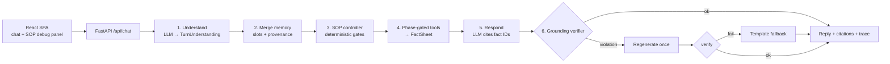
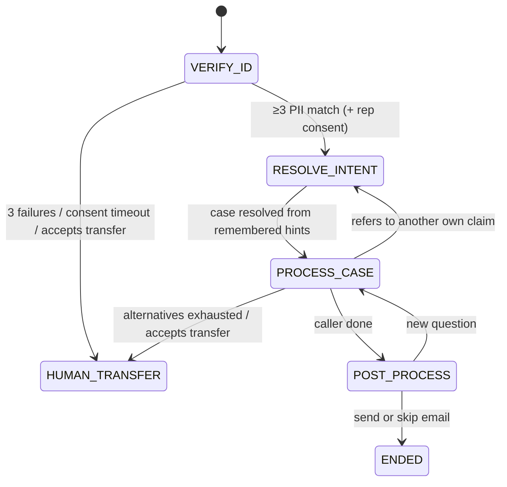

# SOP-Guided Insurance Claims Agent

A conversational insurance-claims support agent that follows a fixed SOP:
**VERIFY_ID → RESOLVE_INTENT → PROCESS_CASE → POST_PROCESS**. It is strict where the SOP demands it
(identity gate, consent, allowed actions), flexible where reasoning helps (messy intent, grounded
follow-ups), and keeps memory across phase boundaries.

The core design principle, taken from how Rasa, Parlant and Sierra solved the same problem (see
[RESEARCH.md](RESEARCH.md)): **the LLM interprets and phrases; deterministic code owns the workflow, the
gates and the data.** Every factual statement the agent makes must cite a fact from a tool result, and a
verifier checks this before each reply is sent.

**Live demo: https://157-230-226-162.sslip.io**. Paste an OpenAI, Gemini or OpenRouter API key into the
key field and start chatting. The server holds no key of
its own: your key is kept in this browser tab's sessionStorage and sent with each request, and the server
passes it on to your provider without storing it.
With no key the demo runs in deterministic offline mode.

## Evaluate in 10 minutes

Open the live demo (or start the app with Docker below) and paste a key. Then use the sample chips under the
chat box, or the **Test cases** drawer, which runs any spec and turns it green or red against its expectations.

| Context.md requirement | Try this in the UI | Spec that proves it |
|---|---|---|
| Demo case: identity + hint in one message, no disclosure before verification | **Demo test case** chip | `margaret_demo_single_utterance` |
| Remember a later-phase hint during VERIFY_ID | **Hint first**, then the identity line | `memory_across_phase_boundary` |
| ≥3 PII, partial answers, alternate fields, refusals | **Wrong DOB**, then **Correction**; **Spoken digits** | `edge_field_correction_after_failure`, `edge_spoken_ssn_dob`, `wrong_details_lockout` |
| Flexible intent + grounded follow-ups | **Follow-up**, **Switch claim**, **Amount** | `grounded_followups`, `edge_switch_*`, `edge_amount_*` |
| Email summary, send or skip | say "that's all" | `email_skip`, `edge_email_statements_grounded`, `edge_transfer_then_email_summary` |
| Out-of-scope refusal, then human after retries | **Off-topic** ×3 | `off_topic_escalation` |
| Bonus: emotion + SOP recovery | **Frustrated** | `frustrated_caller_bonus`, `edge_pushback_and_verify_same_turn` |
| All of it in one messy call | Test cases drawer → `long_messy_12_turns` | `long_messy_12_turns` |

Each reply shows a **grounded** badge, its citations, and its latency, token count and estimated cost. The
right-hand panel shows the phase, identity gate, remembered slots, facts and the full event trace.

## Results at a glance (gpt-5.4-nano)

| Check | Result | Source |
|---|---|---|
| Offline tests (gates, extraction, scenario specs, API) | **197/197** pass | `pytest` |
| Live scenario specs + judged faithfulness, on the live model | **47/48** pass (miss: `edge_amount_paid_on_denied`) | `pytest -m llm` |
| Unseen fixture data the harness was never tuned on | **10/10** scenarios | `evals/report_alt.md` |
| Simulated callers (5 personas × 5 goals × 3 runs) | **71/75** conversations, **23/25** cells pass^3 | `evals/simulation_report.md` |
| Impostor who knows only name + policy number | **never verified** (15/15) | `evals/simulation_report.md` |
| Groundedness judge vs 42 labelled replies | **93%** agreement, κ 0.86, precision 100%, recall 86% | `evals/judge_calibration.md` |
| Agent cost per conversation | **≈ $0.005** | `evals/simulation_report.md` |

Known gaps, shown as measured rather than hidden: a noisy speech-to-text caller asking for a
representative fails 0/3 runs, an adversarial caller fails one of 3 amount runs, and the live amount-on-denied
spec missed once. In the simulated runs, 60 of 295 replies were regenerated after a verifier rejection and 28
fell back to a template. Those fallback rates are the cost of never sending an ungrounded sentence.

## Design trade-offs

- **Code owns the workflow; the model only extracts and phrases.** I chose a deterministic controller with
  gates over one large agent prompt, because a small model follows a long prompt unreliably and the SOP needs
  guarantees ("no claim data before verification") that a prompt cannot give. The cost is more code, and
  less flexibility: a new claim type or SOP step is a code change.
- **A verified template beats an unverified model reply.** A draft that fails the verifier is regenerated
  once, then replaced by a deterministic template. That template is stiffer, but the caller never sees an
  ungrounded sentence. Fallback rates are reported so this doesn't hide model regressions.
- **Regex gates at runtime, LLM judge at eval time.** Gates G1–G9 are fast, free and reproducible, but
  brittle to paraphrase. The judge catches paraphrase but costs a call per reply and misses subtle
  inferences (see calibration), so it measures the system rather than guarding it.
- **A small model plus scaffolding over a bigger model.** Each nano failure seen live became a deterministic
  layer (backfill, input guard, gates) rather than a longer prompt. That keeps a conversation under a cent,
  and any stronger provider/model drops in through the same key field.
- **Correction after a failed match keeps that attempt's fields.** That's better for the caller ("sorry, my
  DOB is …" verifies without repeating name and SSN). The security cost is bounded: the failed field is
  never named, attempts are still counted per distinct combination, and lockout stays at 3.

---

## Quick start

### Docker (one container, one port)

```bash
docker build -t sop-agent .
docker run --rm -p 8000:8000 -e OPENAI_API_KEY=sk-... sop-agent   # or: --env-file .env
# open http://localhost:8000
```

Three providers are supported, all tested live. Use a key either as an env var or pasted into the
**LLM API key** field in the UI. The provider is detected from the key prefix:

| Provider | Key prefix | Env var | Models tried in order | Pin a model |
|---|---|---|---|---|
| OpenAI | `sk-`, `sk-proj-` | `OPENAI_API_KEY` | `gpt-5.4-nano` → `gpt-5.4-mini` | `OPENAI_MODEL` |
| Google Gemini | `AIza` | `GEMINI_API_KEY` | `gemini-3.8-flash` → `gemini-3.5-flash-lite` | `GEMINI_MODEL` |
| OpenRouter | `sk-or-` | `OPENROUTER_API_KEY` | `openai/gpt-5.4-nano` → `google/gemini-3.8-flash` | `OPENROUTER_MODEL` |

OpenRouter is the route to other model families (Claude, Llama, Grok and others): use an OpenRouter key and
type the model id, e.g. `anthropic/claude-sonnet-5-5`, into the optional **Model** field. Anthropic, Groq and
xAI keys are recognised and get a message pointing to OpenRouter, and the session continues in offline mode.

**Model fallback.** Providers retire model ids (Gemini's `gemini-2.5-flash` started returning 404 to new keys).
When a model is reported unavailable, the client moves to the next model in the chain, remembers the working
model for that key, and logs a `model_fallback` event in the trace. A model typed in the UI, or pinned with a
`*_MODEL` env var, is tried first, then the provider's defaults.

**Free-tier quotas.** A free Gemini key allows about 20 requests per model per day, and a turn makes about two
model calls, so that's roughly 10 turns per model. A daily-quota 429 is not retried (backoff can't help
until the next day). The client moves to the next model, which has its own quota. When every model is out,
one short message says so and the turn answers from the verified templates. Per-minute rate limits are
still retried with backoff.

If the prefix is ambiguous, pick the provider in the UI's **Provider** dropdown or set `LLM_PROVIDER`. Any
other OpenAI-compatible endpoint works through `LLM_BASE_URL` + `LLM_API_KEY`. The UI sends the key per
request in the `X-LLM-Key` header (the older `X-OpenAI-Key` header still works) and keeps it only in the
browser's sessionStorage. The mode badge shows `llm:<provider>:<model>`. If the provider rejects the key, or
none of its models is available, one short error appears in the UI. The turn then skips further model calls
and answers from the verified templates. With no key at all, the app runs in
**offline mode** (deterministic regex understanding + template replies), which is useful for trying the SOP
gates without a model.

Optional env vars (see `.env.example`): `OPENAI_MODEL` / `GEMINI_MODEL` / `OPENROUTER_MODEL`
(pin a model for that provider), `LLM_MODEL` and `LLM_JUDGE_MODEL` (apply only to the server's own provider,
i.e. `LLM_PROVIDER` or the env key's provider, so a key pasted for another provider never gets a foreign model
name; the judge defaults to the agent model), `LLM_PROVIDER`, `LLM_BASE_URL`,
`OPENAI_REASONING_EFFORT` (OpenAI only), `AGENT_TODAY` (business date for derived facts such as "appeal deadline
passed"), `LIVE_JUDGE=true` (runs the groundedness judge on every live reply). The old `OPENAI_JUDGE_MODEL`
and `OPENAI_BASE_URL` names still work.

### Local development

```bash
python3 -m venv .venv && .venv/bin/pip install -r apps/insurance_claims/backend/requirements-dev.txt
cd apps/insurance_claims/frontend && npm install && npm run build && cd -   # or `npm run dev` on :5173
cd apps/insurance_claims/backend
OPENAI_API_KEY=sk-... ../../../.venv/bin/uvicorn app.api:app --reload --port 8000
```

### Tests and evals

```bash
cd apps/insurance_claims/backend
../../../.venv/bin/pytest                                   # 197 offline tests, live tests skipped
OPENAI_API_KEY=sk-... ../../../.venv/bin/pytest -m llm      # same scenario specs against the live model + judge
../../../.venv/bin/python -m evals.run_evals --offline      # scorecard -> evals/report.md
# Live (OPENAI_API_KEY set, or in .env):
../../../.venv/bin/python -m evals.run_evals --k 3 --judge --export evals/trajectories.jsonl  # pass^3, faithfulness, cost, RL episodes
../../../.venv/bin/python -m evals.run_evals --k 3 --fixtures ../fixtures_alt               # unseen data -> evals/report_alt.md
../../../.venv/bin/python -m evals.calibrate_judge --runs 3                                 # judge vs labels -> evals/judge_calibration.md
../../../.venv/bin/python -m evals.simulate --runs 3                                        # LLM callers -> evals/simulation_report.md
```

Parallel live runs share one tokens-per-minute limit; `evals.simulate` defaults to 3 workers, and the client
retries 429s with backoff (`LLM_MAX_RETRIES`, default 6; `OPENAI_MAX_RETRIES` still works).

### Submission zip

```bash
scripts/make_submission_zip.sh     # excludes node_modules, dist, .venv, caches, outbox, .env, .claude/
```

---

## Demo walkthrough (the Context.md test case)

Click **Demo test case** in the UI (or type it):

> I'm the policyholder. My name is Margaret Chen, policy POL-9921. I'm calling about my denied healthcare
> claim from January. DOB is 1985-03-15, SSN last four is 4472.

1. **VERIFY_ID.** Name + DOB + SSN-last-4 are extracted. The policy number narrows the lookup but doesn't
   count. Three fields match P9 with no conflicts, so the caller is verified.
2. **Memory.** "Denied healthcare claim from January" was stored as `case_hints` (with the turn it was
   heard on) *before* verification. The agent didn't disclose anything while unverified.
3. **RESOLVE_INTENT.** The hints rank Margaret's claims, and CL-2048 (healthcare, denied, created
   2026-01-12) is selected **without asking from scratch**.
4. **PROCESS_CASE.** The status, denial reason, needed documents and appeal deadline (marked *passed*
   relative to `AGENT_TODAY`) come only from the claim record. Follow-ups such as "how long after I
   submit?", "what format?" or "I don't have the pathology report" are answered from the guideline file.
   Each reply has a **citations** toggle.
5. **POST_PROCESS.** "That's all" brings an offer to email a summary (topics, status, next steps) to the
   masked email on file. The caller chooses **Send** or **Skip**. A sent email is written to
   `backend/outbox/*.json`.

Try the other sample chips too: *Hint first* (memory across turns), *Frustrated* (the bonus
example), *Representative* (consent flow), *Off-topic* ×3, *Injection*, *No document*. The right-hand
panel shows the phase, identity gate, remembered slots, selected case, guardrail counters, email preview,
the facts the responder was allowed to use, and the full event trace.

---

## Architecture

More diagrams are in [`docs/architecture/`](docs/architecture/): system overview, state machine, turn
sequence, and grounding/eval layers.





### How each requirement is met

| Requirement | Mechanism | Code |
|---|---|---|
| Strict VERIFY_ID: ≥3 of name/DOB/phone/email/SSN-4, no disclosure | Deterministic `verify()` (normalization, aliases, 0 conflicts), claim tools gated by phase **and** verification, verifier rejects claim tokens pre-verification, failed field never revealed, lockout after 3 | `sop/verification.py`, `tools.py`, `grounding/verifier.py` |
| Partial answers, refusals, alternate ID fields | Slots accumulate across turns; remaining options offered; SSN or national-ID last 4; name/phone/email aliases | `sop/controller.py::_verify_id` |
| Flexible RESOLVE_INTENT / PROCESS_CASE | LLM interprets messy language into intent/hints/topics; controller ranks claims, disambiguates, switches case | `understanding.py`, `_resolve_intent`, `_process_case` |
| Grounded answers only | FactSheet with IDs, mandatory citations, deterministic verifier, regenerate, template fallback; LLM judge in evals | `grounding/*`, `pipeline.py` |
| Memory across phases | Every message merges into `Memory` with turn provenance, whatever the phase | `_merge_memory` |
| Email summary, send or skip | Summary built deterministically from state + claim record; explicit choice required | `build_email_summary`, `_post_process` |
| Out-of-scope refusal, then human | Input classification, streak counter, transfer offer after 3 | `step()` guards |
| Bonus: emotion + SOP recovery | Emotion signal, empathy first, explain why, offer allowed options, bounded persuasion, escalate | `EMPATHY`, `EXPLAIN_VERIFICATION`, `_offer_human` |
| Representative caller | Rep must be on file (relationship from either side), then policyholder consent via `consent_scenarios.json`; claim data gated until approved | `representative_authorized`, `_consent_step` |

### Grounding: what is checked on every reply

`grounding/verifier.py` rejects a draft if any of the following hold:

- It cites a fact ID that wasn't fetched this turn.
- It names a case ID not in the facts or not owned by the verified caller.
- It states an amount, date or timeline ("within 30 days") not in the facts.
- It names a document not requested for this claim.
- It reads out record PII the caller didn't say.
- A claim's text contains a value its cited facts don't.
- Claim facts exist before verification.

It then runs the **boundary gates** (`grounding/gates.py`). Each gate was added for a failure found in
live evals or the UI, and each traces back to Context.md / RESEARCH.md:

| Gate | Blocks | Example caught |
|---|---|---|
| G1 commitments | promises no fact backs (handoff details, guarantees, speed) | "You won't need to repeat yourself" |
| G2 outcome predictions | predicting approval, payment or consent | "She will approve it", "You'll get $1,450" |
| G3 capabilities | "I can email…", "I can connect you…", "I can only help with…" without the `sop.*`/`email.*` fact | email offer with no email fact |
| G4 state contradictions | telling a verified caller to verify, or an unverified caller they're verified | "I can't skip verification" to a verified caller |
| G5 addressing | calling a representative by the policyholder's name | "Thank you, Margaret" to David |
| G6 scope discipline | answering an off-topic question, or offering a human before the 3-retry threshold | "RL stands for…" |
| G7 session context | "you said / I've noted…" with nothing in memory, or quoting values the caller never typed | "You said your DOB is 2000-12-03" for input "12/03/200" |
| G8 decision fidelity | a reply that doesn't state the controller's outcome, or narrates work that isn't happening | "I've noted your details and I'll check them now" after a failed match |
| G9 amount meaning | a real amount used with the wrong meaning from `claim_schema.json`: the allowed maximum said as a payment, a paid amount called the maximum | "You'll receive $1,450.00" (that is `allowed_max_amount`; `net_pay` is $0.00) |

All gates normalize typographic quotes first (a live reply's "won’t" with U+2019 slipped past ASCII patterns).

**Input-side grounding** (`grounding/extraction_guard.py`, before the controller):
- Every value the model extracts must appear in the caller's own message. An invented year
  ("12/03/200" → 2000-12-03), a model-"corrected" name spelling, a representative's own name used as the
  policyholder's, or a claim status/type/month the caller never said is dropped (or reverted to the
  caller's literal words).
- Dropped identity fields trigger `CLARIFY_FIELDS` and **do not consume a verification attempt**. A value
  with nothing date-like or digit-like in the message was invented, not misheard, so it is dropped silently
  (live: nano re-extracted an earlier DOB from "why didn't that work?" and the agent asked the caller to
  "restate" it).
- **Spoken values** (`text_normalize.py`): "four four seven two", "double four", "nineteen eighty-five",
  "March fifteenth", "margaret at email dot com" are rewritten into written form for the regex extractor and
  this guard. The model and the transcript keep the caller's raw words. Lone number words ("one claim",
  "last four", "first") are left alone.
- Small models also *omit* values. For format-rigid fields (dates, phone, email, ID digits, policy and
  case IDs, claim hints), a regex extractor reading the raw text fills what the model left empty.
  High-precision injection and off-topic detectors and follow-up-topic phrases are OR-ed with the model's
  flags, so one model miss can't reopen a gate.

Text quoted word-for-word from a fact is exempt from G1 and G2 (guideline wording is grounded by definition).
The agent's own rules (`sop.scope`, `sop.human_transfer`, `sop.after_verification`,
`sop.passed_deadline_review`) are emitted as facts, so statements about scope and capabilities are cited
rather than improvised.

A rejected draft is regenerated once with the violations listed, then replaced by the deterministic
template.

### Test layers

1. **Unit** (`test_verification.py`, `test_tools_gating.py`, `test_grounding_verifier.py`, `test_gates.py`,
   `test_session_context_guards.py`): the identity
   rule, tool gates, and **planted hallucinations** (invented amount, date, timeline, document,
   cross-party case, PII read-out), each of which must be caught.
2. **Scenario specs** (`fixtures/specs/scenarios.json`, 16 core + 15 `edge_case` scenarios, each edge case
   tagged with the gate it exercises and the failure it came from): run end to end offline
   (`test_scenarios_offline.py`) and live (`test_scenarios_llm.py`), asserting on phase per turn, verified
   turn, selected case, memory use, email choice, forbidden content and required facts.
3. **Trace properties** (`grounding/trace_rules.py`, AgentLTL-style) on every scenario: no claim tool or
   disclosure before verification/consent, no cross-party disclosure, every reply verified, legal phase
   order, email only after an offer.
4. **LLM path with a fake model** (`test_llm_path_fake.py`): a hallucinating model is caught,
   regenerated, and falls back to the template.
5. **Live evals** (`evals/run_evals.py`): pass^k reliability plus an enumerate-then-verify groundedness
   judge (faithfulness = supported / total claims), and cost and latency per turn.
6. **Unseen data** (`fixtures_alt/`, `test_scenarios_alt.py`): new people, claims, documents, deadlines and a
   representative, with 10 specs that run offline in pytest and live via `run_evals --fixtures`. Building it
   found two couplings to the sample data (G5 read the global repository and silently switched off; the
   offline extractor missed "I'm the policyholder, Jonathan Reyes").
7. **Judge calibration** (`evals/calibrate_judge.py`, `evals/judge_labels.jsonl`): the judge against 42
   labelled replies, 12 of them deliberately borderline. See `evals/judge_calibration.md`.
8. **Simulated users** (`evals/simulate.py`): a second model instance plays the caller (calm, angry, confused,
   adversarial, noisy speech-to-text) for five goals, including an impostor who only knows the name and
   policy number. Scored on the outcome state and every trace property. See `evals/simulation_report.md`.
9. **Trajectory export** (`run_evals --export`): one JSONL episode per conversation, with per-turn
   context and rule rewards. See "Post-training data" below.

---

## Project layout

```
apps/insurance_claims/
  fixtures/                 starter data (+ specs/scenarios.json: executable conversation specs)
  backend/app/
    api.py                  FastAPI endpoints + serves the built SPA
    pipeline.py             per-turn pipeline (understand → controller → respond → verify)
    understanding.py        LLM extraction schema + offline heuristic understander
    sop/controller.py       deterministic SOP state machine
    sop/verification.py     identity matching, normalization, representative rules
    tools.py                phase-gated tools → FactSheet
    responder.py            LLM responder + deterministic template responder
    prompts.py              persona, per-phase rules, per-action instructions
    grounding/              factsheet, verifier, trace rules, LLM judge
    evaluation.py           scenario runner shared by tests and evals
  fixtures_alt/             unseen data + 10 specs (hidden-data robustness)
  backend/app/text_normalize.py   spoken digits / years / emails -> written form
  backend/tests/            pytest suites
  backend/evals/            run_evals (pass^k, judge, cost, trajectories), calibrate_judge, simulate
  frontend/                 Vite + React chat UI with SOP debug panel
docs/architecture/          Mermaid diagrams
RESEARCH.md                 industry research: problems, what worked, what didn't
```

## Limitations

- Sessions are in memory, so they are lost on restart. Email is a mock outbox.
- G9 checks amount meaning with keyword windows ("paid", "maximum") around each amount. A paraphrase with no
  cue word next to the amount is left to the judge.
- Claim types are a fixed list (`healthcare`, `dental`, `auto`) in the extraction schema and the guard.
  Data with a new type (e.g. `home`) needs a one-line change in each place; `fixtures_alt` reuses the
  existing types.
- The judge accepts some subtle inferences (a denial date taken from the creation date, blame on the
  provider, a per-claim cap restated as an annual limit). The deterministic layers are the runtime guard;
  the judge is an eval-time signal. Its labels were written by the author with AI help and need a second
  reviewer.
- Spoken-number handling is English-only and covers digit-by-digit and year forms, not "forty-four
  seventy-two".
- The offline heuristic understander is deliberately simple. Use a model key for natural conversations.
